# USS Fidelity

An LCARS-style ship's console for exploring real NASA and astronomical data, from Earth
orbit out to nearby galaxies. It runs locally. Data is loaded on demand and stored on
your machine.

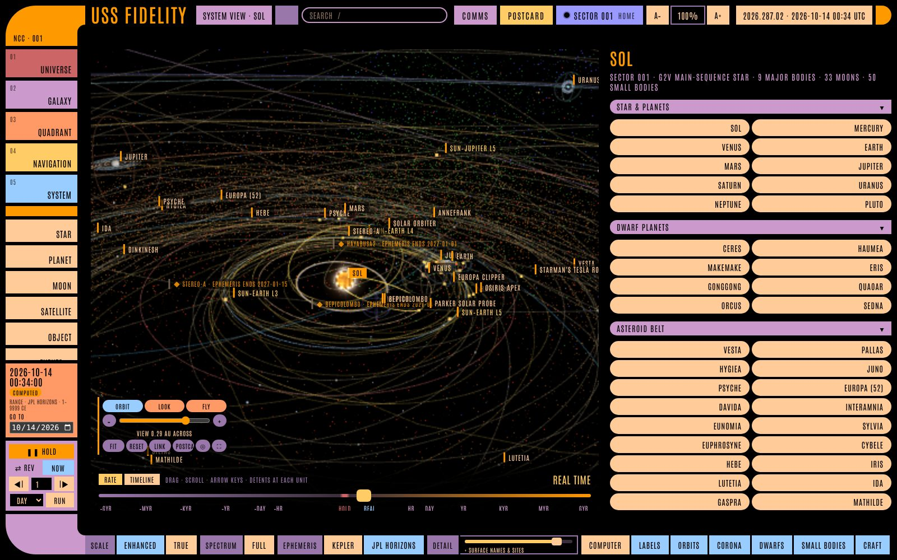

**Status:** version 1.0 ([release notes](docs/release-notes-v1.md)). Every view is online: Universe, Galaxy, Quadrant, Navigation, System (with the Star, Planet,
Moon, Object and Satellite detail views), the surface view, Events, Future, Earth Timeline and COMMS. Open work
is tracked as GitHub issues and mirrored in [`docs/backlog.md`](docs/backlog.md).

## A tour

<table>
<tr>
<td width="50%">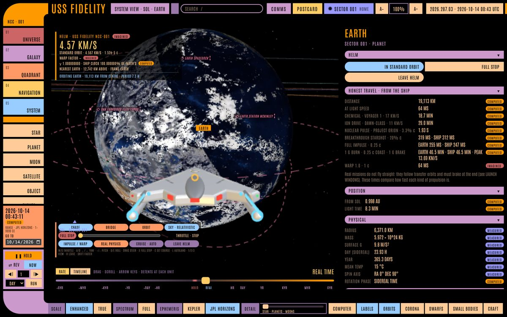<br><b>Take the helm.</b> The USS Fidelity (an original design, IMAGINED) in standard orbit over today's Earth, with an honest-travel panel comparing real propulsion.</td>
<td width="50%">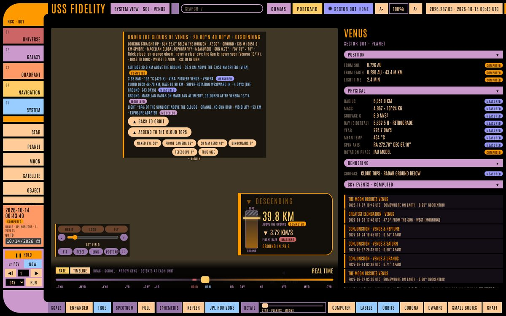<br><b>Land under the clouds.</b> Descending through Venus' cloud deck to the Magellan radar ground, with VIRA pressure and temperature and the descent gauge.</td>
</tr>
<tr>
<td>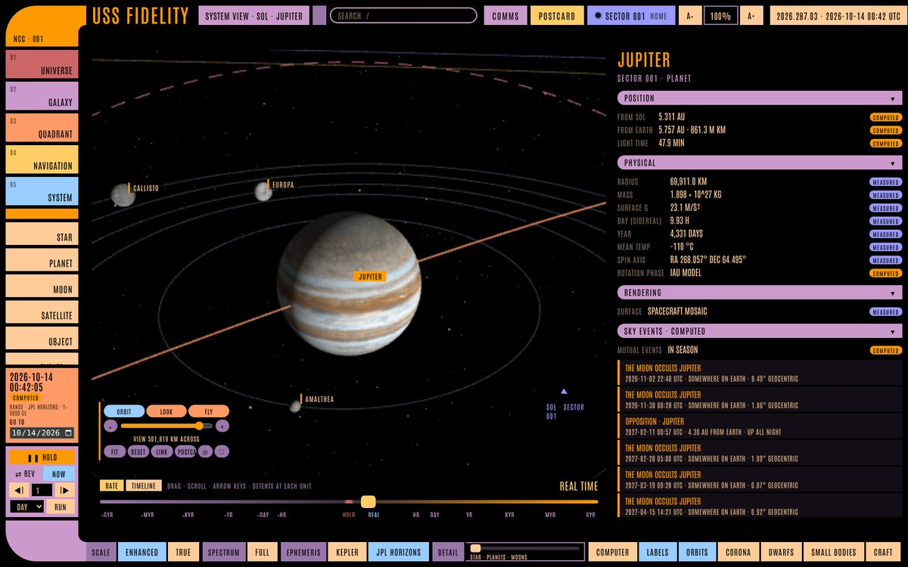<br><b>Jupiter</b> and the Galilean moons on their orbits, wearing spacecraft maps, with the sky events coming up.</td>
<td>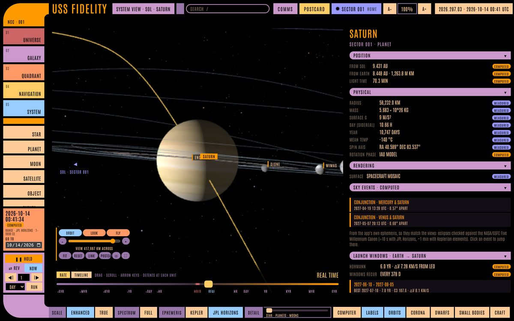<br><b>Saturn</b>, its rings and moons at the ship's clock (Keplerian elements, or JPL Horizons on demand).</td>
</tr>
<tr>
<td>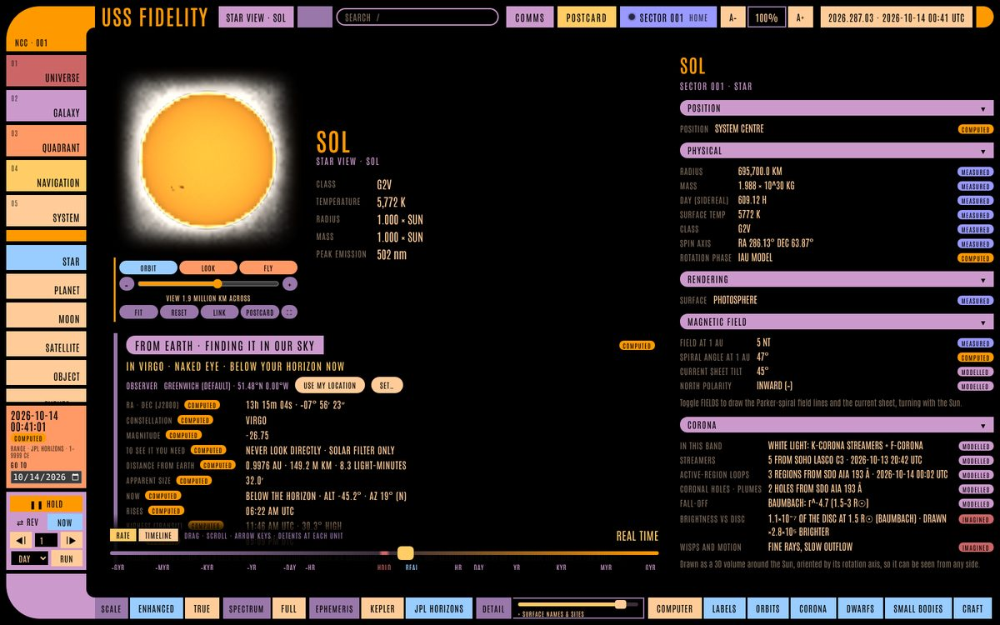<br><b>Star View.</b> The Sun from today's SDO data, its magnetic field and corona, and where to find it in your sky.</td>
<td>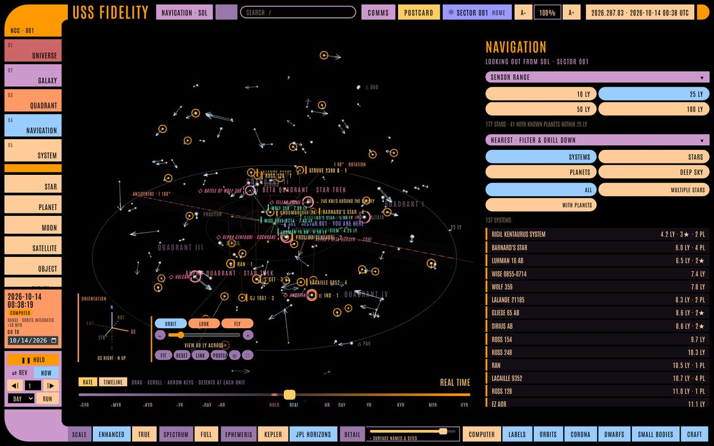<br><b>Navigation.</b> The stars within 10–100 light years in the galactic frame, with motion arrows and the Star Trek quadrants.</td>
</tr>
<tr>
<td>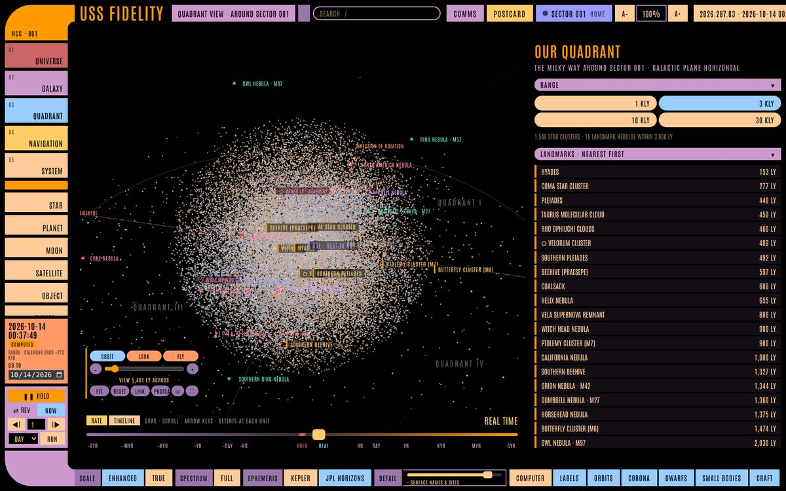<br><b>Quadrant.</b> 7,000 Gaia star clusters and landmark nebulae around Sector 001.</td>
<td>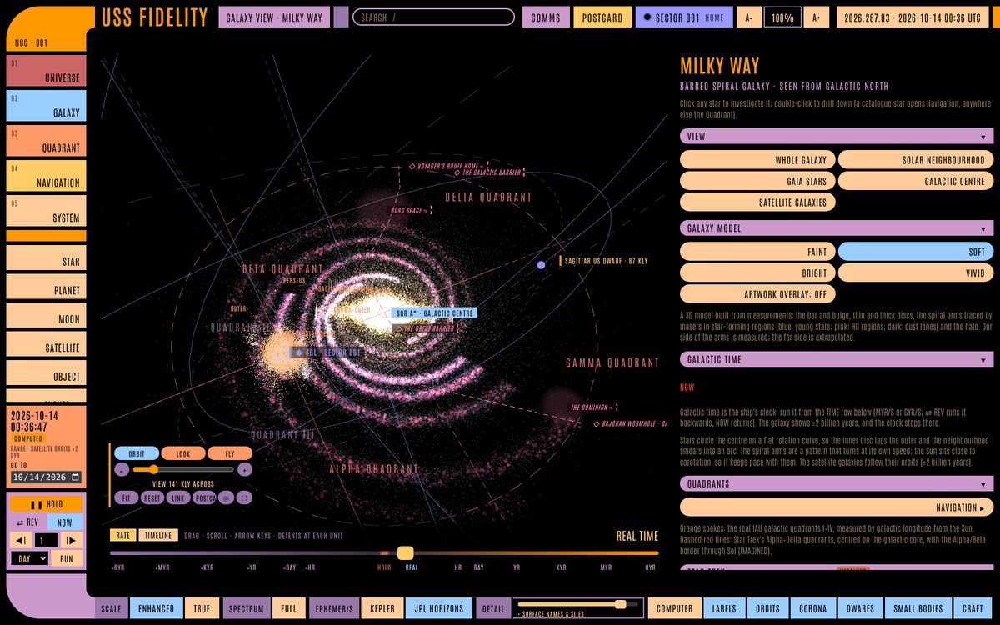<br><b>Galaxy.</b> A 3D Milky Way model calibrated to Sol, with its satellite galaxies.</td>
</tr>
<tr>
<td>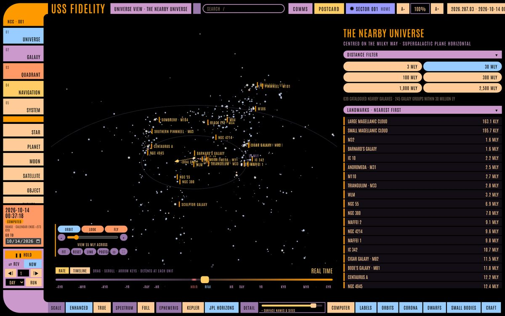<br><b>Universe.</b> Every known galaxy within 36 million light years, and groups out to 2.5 billion.</td>
<td>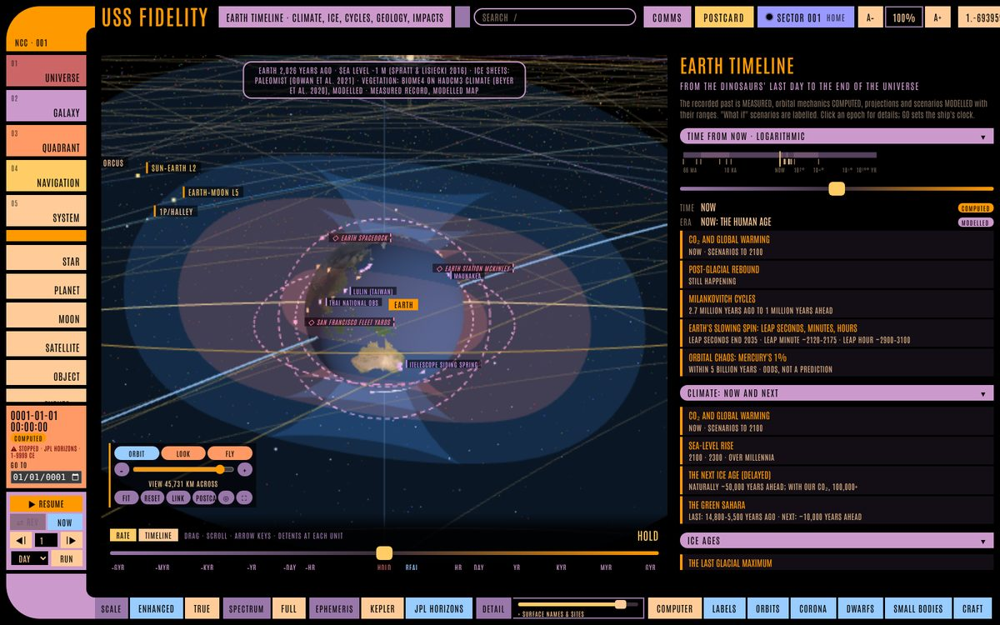<br><b>Earth Timeline.</b> From the dinosaurs' last day to the end of the universe: ice sheets, sea level and vegetation through time.</td>
</tr>
<tr>
<td>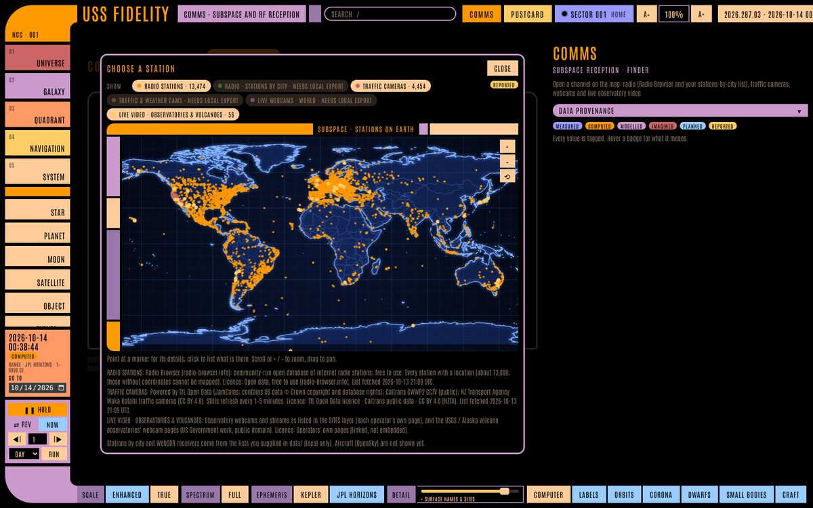<br><b>COMMS.</b> Live radio stations, cameras and public SDR receivers on an LCARS map; hail one onto the main viewer.</td>
<td>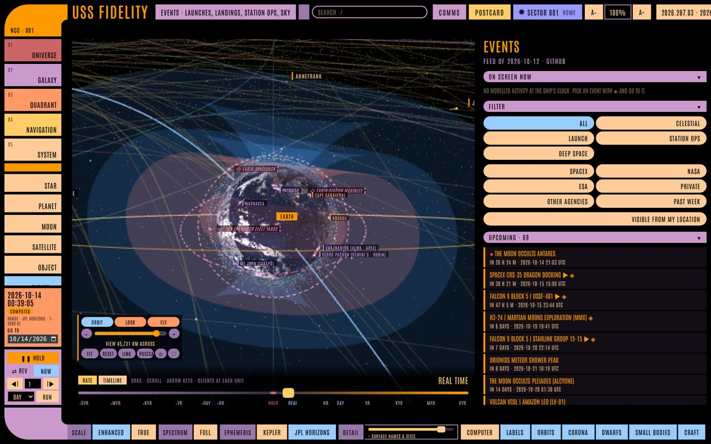<br><b>Events.</b> This week's launches, dockings, landings, eclipses and meteor showers, with webcasts; launches and re-entries replay in 3D.</td>
</tr>
</table>

Screenshots from version 1.0 in Chromium, 14 October 2026 (software rendering, so a real GPU looks sharper). Every
value and picture in the app carries its provenance badge: MEASURED, COMPUTED, MODELLED or IMAGINED.

## Run it

Requires Node 20 or newer.

```bash
git clone https://github.com/Lone-Star-Observatories/fidelity && cd fidelity
npm install
npm run build && npm start        # → http://127.0.0.1:4011
# or, while developing:
npm run dev                       # → http://127.0.0.1:5173 (proxies /api to the backend)
npm test                          # orbital mechanics checked against JPL Horizons
npm run build:standalone          # → dist-standalone/fidelity.html, a backend-free preview
npm run events                    # → events/events.json, the weekly events feed (CI publishes it every Monday)
```

The first Navigation visit downloads the HYG star catalogue (13.6 MB, once) and the NASA
Exoplanet Archive planet list (cached for a week). Both are stored under `data/`.

| Env var | Default | Purpose |
|---|---|---|
| `FIDELITY_PORT` | `4011` | Backend port (binds to `127.0.0.1` only) |
| `FIDELITY_DATA_DIR` | `./data` | Where on-demand downloads are cached |
| `FIDELITY_CATALOG_DIRS` | — | Folders with catalogs you already have (e.g. `/Volumes/DATA/catalogs`); separate several with `:` |
| `FIDELITY_WINDY_KEY` | — | Optional Windy Webcams API key: adds webcams to Earth's live-signals map (#35). Held by the backend only |
| `FIDELITY_EVENTS_URL` | the repo's `events/events.json` on GitHub | Where `/api/events` reads the weekly events feed |
| `FIDELITY_OPENAI_KEY` (or `OPENAI_API_KEY`) | — | Enables the "Computer" voice (OpenAI Realtime). Held by the backend only; the page never sees it |
| `FIDELITY_REALTIME_MODEL` | `gpt-realtime` | Realtime model for the voice |
| `FIDELITY_IMAGE_MODEL` | `gpt-image-1` | Image model for the optional postcard AI STYLIZE step (#40); uses the same OpenAI key, off unless you press STYLIZE |
| `FIDELITY_FAKE_TX` | — | `1` adds a simulated transmitter to COMMS for development (the FM modulator runs, nothing radiates) |

Optional radio hardware for COMMS (#69): an RTL-SDR (`rtl-sdr` tools: `rtl_fm`, `rtl_power`) or a
bladeRF / HackRF through `rx_tools` + SoapySDR receives; an upconverter such as a Ham It Up goes in
COMMS → RF → SIGNAL PATH. Transmitting ("open a hailing frequency 146") needs an amateur radio
licence and a bladeRF (`bladeRF-cli`) or HackRF (`hackrf_transfer`); it stays off until you enter
your callsign, attest your licence and pick an antenna marked for the band in TRANSMIT SETUP, and
never goes through a receive converter (bypass it).

Run `npm run catalogs -- /path/to/catalogs` to see which of your downloaded catalogs the
ship recognises and which view will use each one.

## What you can do today

Every value or picture carries a provenance badge: MEASURED · COMPUTED · MODELLED · IMAGINED · PLANNED ·
REPORTED. Fiction (the Star Trek layer, the ship, warp) is always IMAGINED and never mixed into measured data.

**The Solar System (System View)**
- Fly between the Sun, the planets, 27 moons, the dwarf planets, asteroids and comets, all at their real positions
  for the ship's clock (Keplerian elements offline, **JPL Horizons** on demand), wearing real spacecraft maps.
  Earth has clouds, city lights and a true day/night line; LIVE skins put today's SDO Sun and yesterday's Earth on.
- **ENHANCED** sizes (labelled with the enlargement) or **TRUE** scale; a DETAIL slider adds layers step by step:
  belts from 61,000 real orbits, spacecraft, Lagrange points and Hill spheres, the heliosphere, Earth satellites,
  surface names and sites, spin axes and magnetic fields (MAG FIELDS: dipoles, magnetopauses, bow shocks).
- **Satellites:** all ~16,700 active ones from CelesTrak by SGP4, with telemetry, mission detail and live feeds
  (ISS video, GOES/Himawari Earth, SDO's Sun, Hubble/JWST "observing now" and their newest images).
- **Deep-space fleet:** Voyagers, New Horizons, Parker, JWST, Juno, the Mars orbiters and more from Horizons, with
  NASA DSN Now showing which dish is talking to each.
- **Surface:** double-click a body to stand on it (sky, daylight, the Sun and Moon at true size, the Milky Way, real
  eclipses with the corona). **Sites of note:** 88 landings, rovers with their real traverses (Perseverance,
  Ingenuity, Curiosity, Apollo, Lunokhod…), crash sites, launch sites and 25 observatories with live webcams;
  thousands of IAU named features (Olympus Mons, Jezero, Tycho…). **LOOK AT** any body from a surface or from orbit
  with its true angular size, phase and light-time.
- **Launch windows:** porkchop plots and the next windows from Earth to every planet and small body (Izzo Lambert
  solver, checked against Perseverance), drawn as transfer arcs. **Future missions** appear as PLANNED ghosts.
- **Eclipses, transits and alignments** found by search and shown with real shadows.

**Beyond the Sun**
- **Star View** and **Planet / Moon / Object views:** real spectra and composition, atmospheres, interiors, FROM
  EARTH (where to look tonight, with an eyepiece drawing), FROM THE SURFACE (real landed imagery), crew cards for
  everyone in space now.
- **Other star systems:** Proxima, TRAPPIST-1, τ Ceti and hundreds more from the NASA Exoplanet Archive; binaries on
  measured orbits (Sirius A/B, α Centauri with Proxima, Luhman 16); the real sky as seen from that star.
- **Navigation:** 10–100 ly around any star in the galactic frame, with motion arrows, deep-time arrivals (stars
  integrated through a Milky Way model, ±50 Myr), lists and drill-down, and light-time messages to and from Earth.
- **Quadrant:** 7,000 Gaia star clusters and 29 landmark nebulae (real Hubble/Webb/ESO images, some in 3D).
- **Galaxy:** a 3D Milky Way model and the NASA/JPL-Caltech artwork calibrated to Sol at 26.7 kly, Gaia stars,
  satellite galaxies on their orbits and galactic time to ±2 Gyr.
- **Universe:** every known galaxy within 36 million ly (17 with real images) and 38,000 groups to 2.5 billion ly.

**Time, light and the spectrum**
- One clock for every view: real time up to ±1 Gyr/s, a TIMELINE scrubber, STEP and NOW; each view clamps to the
  range its model is valid for and says why.
- **SPECTRUM:** filter every view through any band or a custom transmission curve from gamma rays to radio; real
  maps where they exist (SDO, Helioviewer, survey HiPS), honest predictions elsewhere, NOT OBSERVED where nothing
  emits.

**Events, the future and Earth's past**
- **EVENTS:** this week's launches, dockings, spacewalks, landings, eclipses, meteor showers and aurora watches,
  with webcasts; GO TO EVENT replays launches and re-entries in 3D; VISIBLE FROM MY LOCATION.
- **FUTURE:** supernova scenarios (Betelgeuse, Eta Carinae…), passing stars (Gliese 710), Apophis 2029, the live
  impact-risk lists, pole stars and the constellations in 100,000 years.
- **TIMELINE:** Earth's climate cycles, ice ages, sea level and coastlines through time (vegetation by epoch, the
  Green Sahara), plate motions and impacts.

**The ship**
- **Fly the USS Fidelity:** TAKE THE HELM in any system (an original ship design, IMAGINED): chase and bridge
  cameras, manoeuvring thrusters to full impulse and warp (TNG scale), SET COURSE autopilot into standard orbit,
  warp to nearby stars, a REAL PHYSICS mode, and an honest-travel panel (light, Voyager, ion, Orion, Starshot,
  relativistic ship time).
- **Star Trek layer** (on by default, one toggle): the Alpha–Delta quadrants, Vulcan at 40 Eridani A and other worlds
  at their real stars, territories, starbases, Utopia Planitia and Voyager's route home, each with its canon source.
- **COMMS:** an LCARS line-art map of Earth's live radio stations, traffic and observatory cameras and public SDR
  receivers; HAIL one onto the main viewer. Optional local radio hardware for reception (and, licensed, transmission).
- **Computer:** a local wake word and the OpenAI Realtime voice (key kept in the backend) that answers about what's
  on screen, runs the ship's calculators and can fly, set course and change layers.
- **POSTCARDS** from any view, framed and credited; a top-bar SEARCH across bodies, spacecraft, stars and events;
  LINK bookmarks with camera and time.

## Docs

- [`docs/concept.md`](docs/concept.md): the vision, the scale ladder and the decisions so far
- [`docs/data-sources.md`](docs/data-sources.md): which data feeds which view
- [`docs/architecture.md`](docs/architecture.md): how the app is built, and how to add a view
- [`docs/assets.md`](docs/assets.md): the 3D models, maps and imagery, with their sources and processing
- [`docs/backlog.md`](docs/backlog.md): planned work

MIT licensed (see `LICENSE`). LCARS is a fan homage to the Star Trek: The Next Generation console design, and the
Star Trek layer is a fan homage with original text and no franchise artwork. Star Trek is a trademark of Paramount /
CBS Studios; this is a non-commercial project and is not affiliated with them.
